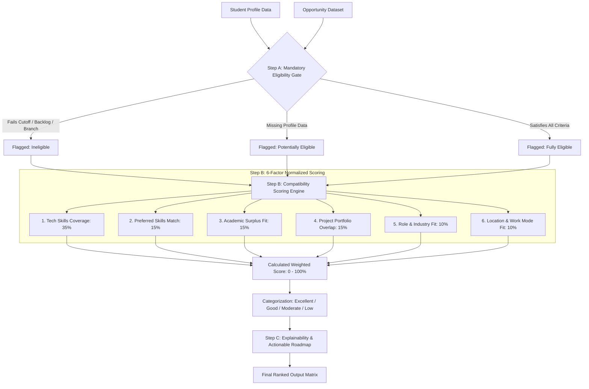

# System Architecture & Recommendation Flow
## CareerMatch AI — Placement Opportunity Recommendation System
**Artificial Intelligence Project-Based Learning (AI PBL)**

---

## 1. Executive Summary

**CareerMatch AI** is an intelligent, full-stack placement recommendation and skill-gap analysis platform. Built for university placement cells and graduating students, the system eliminates blind applications and high candidate rejection rates by combining:
1. **Mandatory Eligibility Filtration Gates** (hard Boolean constraints: CGPA cutoffs, backlog tolerances, graduation batches, degrees, and branches).
2. **6-Factor Normalized Weighted Scoring Algorithm** (quantifying technical skill coverage, bonus skills, academic surplus, project proof-of-work, role, and location preferences).
3. **Explainable AI (XAI)** outputs generating natural language justifications and actionable upskilling roadmaps.

---

## 2. High-Level Multi-Tier Architecture

```
┌─────────────────────────────────────────────────────────────────────────┐
│                        PRESENTATION LAYER                               │
│  React.js (Vite) + Tailwind CSS + Recharts + Lucide Icons + React Router│
│  - Student Dashboard & Profile Editor      - Recommendation Visualizer  │
│  - Skill-Gap Matrix & Comparison Table     - Grounded AI Assistant Chat │
│  - Pipeline Application Tracker            - Placement Admin Portal     │
└────────────────────────────────────┬────────────────────────────────────┘
                                     │ JSON over HTTPS (REST API)
                                     ▼
┌─────────────────────────────────────────────────────────────────────────┐
│                          API GATEWAY & AUTH                             │
│  Python Flask Application Factory + Flask-CORS + Flask-JWT-Extended     │
│  - Werkzeug SHA-256 Hashing                - Role-Based Access Control  │
│  - JWT Bearer Authentication               - Request Validation         │
└────────────────────────────────────┬────────────────────────────────────┘
                                     │
           ┌─────────────────────────┴─────────────────────────┐
           ▼                                                   ▼
┌───────────────────────────────────────┐   ┌───────────────────────────────┐
│           AI ENGINE SERVICES          │   │      PERSISTENCE LAYER        │
│ - EligibilityService (Gate Evaluation)│   │  Flask-SQLAlchemy ORM         │
│ - RecommendationEngine (6-Factor Math)│   │  SQLite (Prototype) / Postgres│
│ - SkillGapService (Roadmap Matrix)    │   │  - Users & Student Profiles   │
│ - ResumeService (NLP Keyword Overlap) │   │  - Placement Opportunities    │
│ - AssistantService (Grounded Chatbot) │   │  - Applications & Bookmarks   │
└───────────────────────────────────────┘   └───────────────────────────────┘
```

---

## 3. The Recommendation Data Flow



---

## 4. Mathematical Formulation

### 4.1 Compatibility Score Formula
For any candidate $S$ and opportunity $O$:

$$\text{Final Compatibility Score}(S, O) = \sum_{i=1}^{6} (C_i \times W_i)$$

Where each component score $C_i \in [0, 100]$ and $\sum W_i = 1.00$.

### 4.2 Scoring Components Breakdown

| Component ($C_i$) | Default Weight ($W_i$) | Mathematical Evaluation | Normalization Logic |
|---|---:|---|---|
| **$C_1$: Required Skills** | **35%** | $\frac{\lvert \text{Matched Required} \rvert}{\lvert \text{Total Required} \rvert} \times 100$ | Normalized alias matching (e.g. `react` = `react.js`). If no required skills, defaults to 100%. |
| **$C_2$: Preferred Skills** | **15%** | $\frac{\lvert \text{Matched Preferred} \rvert}{\lvert \text{Total Preferred} \rvert} \times 100$ | Evaluates bonus qualifications. Neutral baseline 80% if unlisted. |
| **$C_3$: Academic Fit** | **15%** | $70 + \min\left(\frac{\text{CGPA} - \text{Min CGPA}}{3.0}, 1.0\right) \times 30$ | Rewards academic surplus above cutoff. Branch alignment scales $\times 1.1$. |
| **$C_4$: Projects & Certs** | **15%** | $\min(100, 20 \times \text{Projects} + 15 \times \text{Certs} + 10 \times \text{Tech Overlap})$ | Measures practical proof of work in student GitHub projects. |
| **$C_5$: Role & Industry** | **10%** | Binary / Substring keyword alignment | $100\%$ if both role & industry match; $80\%$ if role matches; $65\%$ if industry matches. |
| **$C_6$: Location & Mode** | **10%** | Constraint satisfaction | $100\%$ if preferred city and work mode match (or Remote). |

---

## 5. Score Tiers & Interpretability

| Tier | Numerical Range | System Interpretation | UI Representation |
|---|---|---|---|
| **Excellent** | $80.0\% - 100.0\%$ | Top-tier candidate. High shortlisting probability. | Emerald Badge & High-priority callout |
| **Good** | $65.0\% - 79.9\%$ | Strong contender with minor skill or preference gaps. | Teal Badge |
| **Moderate** | $45.0\% - 64.9\%$ | Candidate meets partial prerequisites. Targeted upskilling advised. | Amber Badge |
| **Low** | Below $45.0\%$ | Significant qualification or domain mismatch. | Rose Badge |

---

## 6. Mandatory Eligibility Gate Logic

Unlike standard recommendation algorithms that rank solely on continuous score vectors, **CareerMatch AI enforces hard corporate gate rules**:

1. **CGPA Gate**: $\text{Student.CGPA} \ge \text{Opportunity.Min\_CGPA}$
2. **Backlog Gate**: $\text{Student.Backlogs} \le \text{Opportunity.Max\_Backlogs}$
3. **Degree & Branch Gate**: $\text{Student.Branch} \in \text{Opportunity.EligibleBranches}$
4. **Graduation Batch Gate**: $\text{Student.GradYear} \in \text{Opportunity.EligibleYears}$
5. **Prior Experience Gate**: $\text{Student.ExperienceYears} \ge \text{Opportunity.ExperienceRequired}$

If any rule fails, the opportunity is categorized as **Not eligible**, preventing students from applying to drives for which they would be automatically disqualified by company HR filters.

---

## 7. Explainable AI (XAI) & Skill-Gap Roadmap

The system generates transparent reasoning for each match:
- Exact list of matched mandatory and preferred skills.
- Explicit list of missing skills categorized by urgency (**High Priority** for mandatory gaps, **Medium Priority** for preferred gaps).
- Estimated preparation time (e.g. `2-3 weeks` for Docker) and curated documentation resources.
